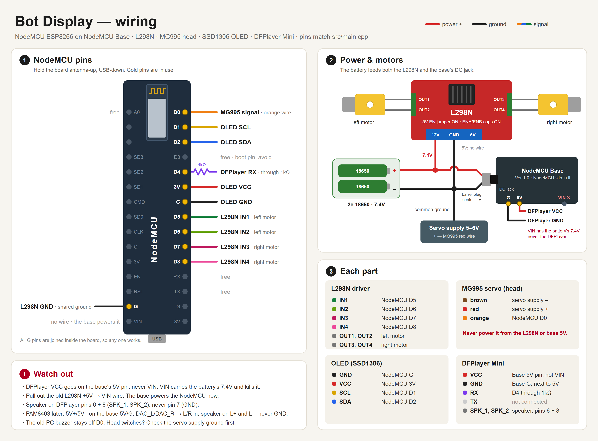

# Bot Display robot

A small two-wheel robot with a face. A NodeMCU (ESP8266) drives the wheels, shows animated eyes on an OLED, turns its head with a servo, and plays music from an SD card. You drive it from your phone's browser over WiFi.



## What it does

- **Phone remote:** a joystick, plus a **Dance** button, a **Bird Song** button and voice commands. Open the robot's IP address in any phone browser on the same WiFi. You don't need to install an app.
- **Face:** the eyes look the way the robot is moving, and the head servo turns with them. After a move, the eyes squint happily.
- **Bored mode:** after 1 minute with no command the robot falls asleep. 2 minutes later it wakes up and plays little games on the screen (ball, pong, dizzy, dance, peekaboo), switching to a new game every 20 seconds.
- **Music:** every expression, game and dance has its own chiptune track.
- **Dance:** each press of Dance plays the next of 3 dances (wiggle, penguin waddle, cha-cha), with wheel moves timed to the music.
- **Bird Song:** each tap plays the next of your own songs from the SD card. Moving the joystick stops the song.
- **Safety stops:** forward and back stop by themselves after 3 seconds, and a turn lasts 0.4 seconds. If the phone loses connection, the joystick stops the wheels within half a second.

## Parts

| Part | Job |
|---|---|
| NodeMCU ESP8266 (v2) | the brain, WiFi |
| NodeMCU Base Ver 1.0 | holds the NodeMCU, DC jack, 5V for the DFPlayer |
| L298N motor driver + 2 DC gear motors | wheels |
| MG995 servo | head |
| SSD1306 OLED, 0.96" 128×64 (I2C) | face |
| DFPlayer Mini + micro SD card + 8Ω speaker | music |
| 2× 18650 (7.4V) | battery |
| separate 5–6V supply | servo power |
| 1kΩ resistor | between D4 and the DFPlayer RX |

## Wiring

| NodeMCU pin | Goes to |
|---|---|
| D0 | MG995 signal (orange) |
| D1 | OLED SCL |
| D2 | OLED SDA |
| 3V, G | OLED VCC, GND |
| D4 | 1kΩ → DFPlayer RX |
| D5, D6 | L298N IN1, IN2 (left motor) |
| D7, D8 | L298N IN3, IN4 (right motor) |
| G | L298N GND (shared ground) |

**Power:**
- The battery feeds the **L298N 12V** screw and the base's **DC jack** (center pin +).
- **DFPlayer VCC goes on the base's 5V pin, never VIN.** VIN carries the battery's 7.4V, and the DFPlayer takes 5.0V max.
- The MG995 runs on its own 5–6V supply, with its ground joined to the rest. It pulls too much current for the L298N or base 5V.
- On the L298N, leave the 5V-EN jumper and the ENA/ENB jumper caps on.
- The speaker goes on DFPlayer pins 6 and 8 (SPK_1, SPK_2), never pin 7.

[wiring.svg](wiring.svg) is the same diagram as an editable vector file.

## Build and upload

1. Install [VS Code](https://code.visualstudio.com/) with the [PlatformIO](https://platformio.org/) extension, then open this folder.
2. Copy `include/secrets.example.h` to `include/secrets.h` and fill in your WiFi. It must be a 2.4 GHz network, because the ESP8266 can't see 5 GHz. Git ignores `secrets.h`, so your password stays on your PC.
3. Plug in the NodeMCU over USB and click **Upload**. PlatformIO installs the Adafruit SSD1306 and GFX libraries by itself.
4. The OLED shows the robot's IP address for 10 seconds after it joins your WiFi. Open `http://<that IP>` on your phone.

## SD card

Format the card as FAT32 and lay it out like this:

```
mp3/0001_forward.mp3 … 0014_dance_chacha.mp3   the robot's sounds, unzip music/sd_card.zip
01/001_any-name.mp3                            your songs for the Bird Song button
01/002_any-name.mp3
```

The DFPlayer only finds folders with 2-digit names and files that start with a number, so keep those prefixes. When you add more Bird Songs, raise `BIRD_SONGS` in `src/main.cpp` to the new total.

### Making the robot's music

The 14 sound tracks are composed in code:

```
pip install lameenc
python music/make_music.py
```

This writes a fresh `music/sd_card.zip`. The order of tracks in the script must match `tracks[]` and `gameTracks[]` in `src/face.cpp` and `dances[]` in `src/main.cpp`.

## Settings worth tweaking

All of these are at the top of `src/main.cpp`:

| Setting | What it changes |
|---|---|
| `HEAD_CENTER` | the servo angle that faces straight ahead |
| `HEAD_RANGE` | how far the head turns, make it negative if it turns the wrong way |
| `MP3_VOLUME` | 0–30 |
| `DRIVE_SPEED`, `TURN_SPEED` | wheel speed, 0–255 |
| `JOY_MIN_SPEED` | raise it if small joystick pushes only make the motors hum |
| `SCREEN_HEIGHT`, `OLED_ADDR` | 32 for a 0.91" OLED, try `0x3D` if the screen stays blank |

## Voice commands

Tap **Start voice** or type in the box under it. The robot understands *forward, go, ahead, back, reverse, left, right, stop, halt, dance*. The browser's voice button needs internet on the phone, and Chrome blocks it on plain `http` unless you allow it in `chrome://flags`. The keyboard's own mic button works everywhere.

## Troubleshooting

- **No music:** the DFPlayer's LED lights only while it plays. If it lights but you hear nothing, check that the speaker is on pins 6 and 8. If it never lights, check the 5V and GND to the DFPlayer and the SD card layout.
- **"OLED not found" in the serial monitor:** check SDA and SCL, then try `OLED_ADDR 0x3D`.
- **Head twitches or the NodeMCU resets when moving:** the servo is probably sharing power it shouldn't. Give it its own supply and join the grounds.
